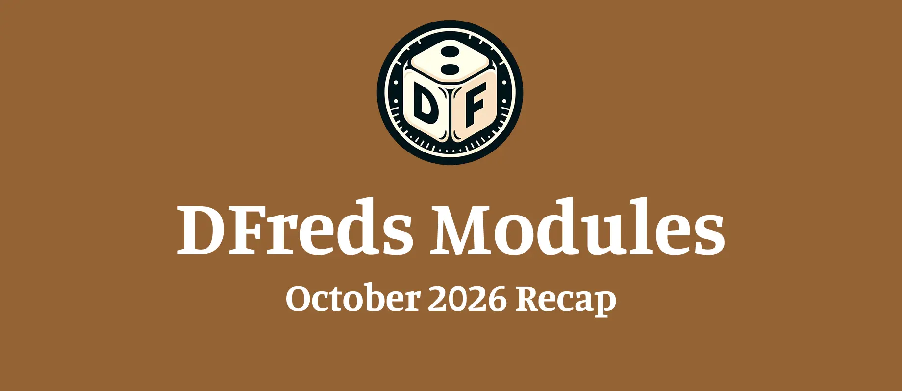

Hope October brought some good tabletop sessions your way.

<!-- truncate -->

Here's what changed across my modules this month.

## Premium Modules

### DFreds Clipboard
*v3.1.3 to v3.1.4*

**New**
- Clipboard hints now display level names instead of raw level IDs.

**Fixed**
- Light hints correctly display "Walls Block" and "Provides Vision" again.
- Toggling the "Show Hints" checkbox itself now properly switches hints on and off (instead of requiring a click on the label).
- Clicking the scene control Clipboard button while a window is already open now reuses and switches the active window rather than spawning a duplicate.
- The Clipboard window now auto-refreshes when a region updates.
- Pasting an item from history no longer treats the action as a cut if your previous action was a cut.
- Copied objects are once again accessible to Foundry core and other modules.

### DFreds Status Effects
*v3.2.5*

**New**
- If no status effects are configured, the warning now includes a direct "Configure" button (requires DFreds Notifications).

**Fixed**
- Right-clicking the status effects palette no longer triggers the native browser context menu.
- Creating multiple status effects simultaneously now correctly assigns unique sort positions to each.
- Effects without a tint color now show up properly in the status effects config.
- Fixed an issue where the dnd5e item type migration could cause the status effects item to be lost.
- Improved performance when reordering status effects in the config.

### DFreds Triggers
*v1.2.1*

**Fixed**
- Values starting with `@` now support system-specific shorthand (e.g., `@abilities.str.mod`) inside conditions, "Roll a formula", and property-setting actions.
- Chat messages sent using the "You" speaker now display your actual username instead of the selected token name.
- Fixed missing/broken text in trigger deletion confirmation dialogs.
- Fixed rendering issues with trigger names containing special characters in delete dialogs.

---

## Free Modules

### DFreds Chat Pins
*v6.1.2*

**New**
- Clicking a roll inside the Chat Pins window now expands the breakdown, matching core chat behavior.
- Added support for revealing and hiding secret blocks in pinned messages directly from the Chat Pins window.
- The right-click menu in the Chat Pins window now mirrors core chat options, including context items added by third-party modules.
- Pinned messages now visually match standard chat log entries and update immediately when edited.

**Fixed**
- Clicking the pin button with the Chat Pins window open now focuses the existing window instead of launching a second instance.
- Fixed the header title on the "Delete All Except Pins" confirmation dialog.
- Fixed a permission exploit that allowed players to pin/unpin messages while user-impersonating.

### DFreds Effects Panel
*v6.2.4 to v6.2.5*

**New**
- Shift + right-click actions can now also be triggered with Alt + right-click to fix compatibility with Firefox.
- Right-clicking locked item effects now shows an "Open Item" shortcut in the warning prompt (requires DFreds Notifications).
- Added translation support for "Temporary" and "Passive" tags, along with new Spanish, Italian, and Romanian translations.

**Fixed**
- Group dividers in the panel now scale correctly with the Icon Size setting.
- Fixed character encoding issues in delete/disable dialogs for effect names with special characters.
- Fixed an issue allowing the panel to be dragged off-screen past the bottom edge.

### DFreds Notifications
*v1.1.0 to v1.1.1*

**New**
- Added the ability to mute specific notifications by right-clicking them in history.

**Fixed**
- Prevented notification action failures from breaking the notification toast or freezing the history sidebar.

### DFreds Convenient Effects
*v9.2.8*

**New**
- Added a "View Backups" button to the notification triggered when built-in backups update (requires DFreds Notifications).

**Fixed**
- Addressed a potential loss of convenient items during dnd5e item type migration, including automatic restoration if a migration fails.
- Importing data into an item now properly awaits completion before executing dependent logic.

### DFreds Droppables
*v6.2.2*

**Fixed**
- Resolved duplicate drop processing when switching scenes.
- Dropped image and video links now support all media formats recognized by Foundry core.

### Lib: DFreds UI Extender
*v2.6.0*

**New**
- Added support for building HUD buttons using vanilla HTML elements instead of jQuery.

**Fixed**
- Content inside compare blocks can now properly resolve context variables from surrounding templates.
